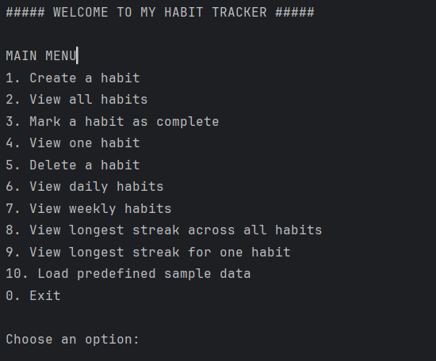
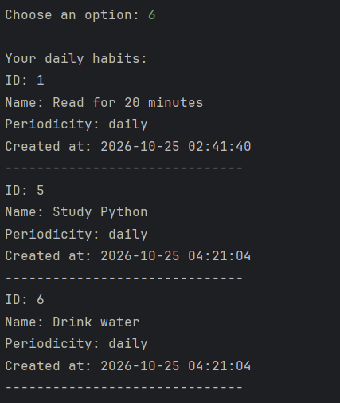

# Habit Tracker

A Python command-line application for creating and managing daily and weekly habits, recording completions, storing data in SQLite, and analysing habit consistency through streak calculations.

**Repository:** [https://github.com/Nzams25/habit-tracker](https://github.com/Nzams25/habit-tracker)

## Project Overview

Habit Tracker was developed as a learning project to practise Python programming, object-oriented programming, relational database management, analytical computations, and software testing.

The application allows users to create habits, record completions, review completion history, filter habits by frequency, and calculate the longest daily and weekly completion streaks.

## Features

- **Habit management:** Create, track, complete, and manage habits.
- **Daily and weekly habits:** Supports `daily` and `weekly` periodicity.
- **Persistent storage:** Stores habits and completion timestamps in SQLite.
- **Habit filtering:** View daily habits and weekly habits separately.
- **Streak analytics:** Compute maximum streak lengths for specific habits as well as system-wide.
- **Sample data:** Populate the database with five default habits and sample completion data.
- **Input validation:** Enforces valid periodicity values (`daily` and `weekly`) when adding habits.
- **Automated testing:** Uses Python's built-in `unittest` framework.

## Technologies

| Technology | Purpose |
|---|---|
| Python 3 | Application logic and command-line interface |
| SQLite | Saves habits and completion histories to long-term storage |
| sqlite3 | Python interface to SQLite |
| datetime | Timestamps and date-based streak calculations |
| unittest | Automated testing |

The project uses Python's standard library and does not require a separate database server or third-party packages in its current implementation.

## Project Structure

| File | Responsibility |
|---|---|
| `main.py` | Command-line menu and application flow |
| `habit.py` | Habit class setup and data checks |
| `database.py` | SQLite database operations |
| `analytics.py` | Daily, weekly, and streak-duration calculations |
| `sample_data.py` | Predefined habits and demonstration records |
| `test_habit.py` | Tests for habit behaviour |
| `test_database.py` | Tests for database operations |
| `test_analytics.py` | Tests for streak calculations |
| `README.md` | Project documentation |

The application creates `habits.db` locally when using its default database configuration. The local database file is kept out of source control.

## Installation and Setup

### Requirements

- Python 3
- Git (required only when cloning the repository)
- A standard command-line terminal or Python IDE such as PyCharm

### 1. Clone the repository

Open a terminal and execute:

```bash
git clone https://github.com/Nzams25/habit-tracker.git
```

Navigate into the project directory:

```bash
cd habit-tracker
```

Alternatively, download the repository as a ZIP file from GitHub and extract it.

### 2. Check Python Installation

Check your Python version:

```bash
python --version
```

On some Windows installations, use:

```powershell
py --version
```

### 3. Run the application

Run the application:

```bash
python main.py
```

### 4. Run the automated tests

Execute:

```bash
python -m unittest discover -v
```

On Windows, you can also use:

```powershell
py -m unittest discover -v
```

The application uses Python's standard library and SQLite, so no third-party package installation is required.

## Using the Application

The command-line menu provides the following actions:

| Option | Action |
|---|---|
| `1` | Create a habit |
| `2` | View all habits |
| `3` | Mark a habit as complete |
| `4` | View one habit and its completion history |
| `5` | Delete a habit |
| `6` | View daily habits |
| `7` | View weekly habits |
| `8` | Find the longest streak across all habits |
| `9` | Find the longest streak for one habit |
| `10` | Load predefined sample data |
| `0` | Exit |

Follow the prompts displayed in the terminal. Enter a habit name and select either `daily` or `weekly` when creating a habit.

## Sample Data

The sample-data loader provides five predefined habits:

- Read for 20 minutes — daily
- Exercise — weekly
- Study Python — daily
- Drink water — daily
- Plan the week — weekly

The sample-data loader generates up to four weeks of sample history, automatically skips duplicate habit titles, and avoids adding sample completions when tracking data is already present.

The sample dataset is strictly intended for testing and demonstration purposes and does not reflect actual user behavior.

## Streak Analytics

The application analyses saved completion timestamps.

- **Daily streak:** Consecutive calendar dates with at least one recorded completion.
- **Weekly streak:** Consecutive ISO calendar weeks with at least one recorded completion.
- **Longest streak for one habit:** Finds the maximum valid streak for an individual habit.
- **Longest streak across all habits:** Compares streak durations across saved habits.

For weekly streak-duration comparisons, the implementation uses elapsed calendar days between the relevant week boundaries. Rather than simply counting weekly completions, this calculation evaluates consecutive activity periods.

## Database Design

The SQLite database contains two related tables:

### habits

Stores each habit's ID, name, periodicity, and creation timestamp.

### completions

Stores each completion's unique ID, associated habit ID, and completion timestamp.

The database enforces foreign key relationships. When a habit is deleted, its associated completion records are also deleted through cascading deletion.

## Running the Tests

The project uses Python's built-in `unittest` framework.

Run an individual test module:

```bash
python -m unittest test_habit.py
python -m unittest test_database.py
python -m unittest test_analytics.py
```

Run all discovered tests:

```bash
python -m unittest discover -v
```

## Test Status

The latest reported test run completed with 24 passing tests:

- Habit tests: 10
- Database tests: 5
- Analytics tests: 9

These results reflect the reported test run. Run test suites after edits to confirm system stability.

## Limitations

- The application uses a command-line interface rather than a graphical or web interface.
- It does not currently send reminders or automatically enforce a habit schedule.
- Analytics depend on the recorded completion timestamps and the implemented streak rules.
- Sample completion records are not added to a predefined habit that already has completion history.
- Passing unit tests does not guarantee that every possible input or edge case has been tested.

## Future Improvements

Possible extensions include:

- Improve sample-data loading for habits with partial completion histories.
- Add current-streak and completion-percentage analytics.
- Expand tests for edge cases and invalid inputs.
- Add a graphical or web interface.
- Improve reporting and data visualisation.

## Learning Outcomes

This project provided practical experience with:

- Python classes, functions, loops, conditions, and exception handling
- SQLite tables, queries, relationships, and persistent storage
- Date and timestamp processing
- Separating application logic into modules
- Automated unit testing
- Git and GitHub version control

## Project Demonstration

### Application Menu



### Daily Habits



---

**Author:** Bwene Nzams

**Status:** Learning project — ongoing development and documentation improvements.
